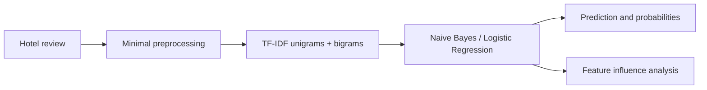

# ReviewGuard: Detecting Deceptive Online Reviews Using NLP

ReviewGuard is a reproducible college NLP project that classifies hotel reviews as **truthful** or **deceptive**. It compares TF-IDF + Multinomial Naive Bayes with TF-IDF + Logistic Regression, then examines the trained model's influential features and descriptive linguistic patterns.

## Problem statement

Online-review platforms may include fabricated content that manipulates customer perception. This project uses classical NLP and machine learning to model labels in the Deceptive Opinion Spam Corpus while making its dataset limitations explicit.



## What it includes

- Automatic CSV/TSV discovery and cautious schema/label inference
- Minimal cleaning: HTML decoding, whitespace normalization, lowercase text
- Leak-safe stratified train/test split and scikit-learn pipelines
- Accuracy, precision, recall, F1, reports, confusion matrices, and 5-fold CV
- Misclassification report, influential-word ranking, and linguistic summaries
- Optional hotel-held-out experiment when a hotel column is available
- Persisted Logistic Regression pipeline plus a Streamlit demonstration app

## Dataset

Place an authorized CSV or TSV copy of the **Deceptive Opinion Spam Corpus** in [`data/`](data/README.md). The data is not bundled with this repository. The loader supports common review and target column names and converts labels to `0 = truthful`, `1 = deceptive`.

When inference is unclear, name columns directly:

```bash
python -m src.train --data-file data/reviews.csv --text-column review --label-column deceptive
```

## Installation

```bash
git clone <your-repository-url>
cd NLPCA3
python -m venv .venv
source .venv/bin/activate  # Windows: .venv\\Scripts\\activate
pip install -r requirements.txt
```

## Train and evaluate

```bash
python -m src.train
```

To run the optional TF-IDF representation experiment (unigrams, unigrams +
bigrams, and English stopword removal), use training-set cross-validation only:

```bash
python -m src.train --compare-tfidf
```

Training generates `models/reviewguard_logistic_regression.joblib`, `models/model_metadata.json`, and reports under `reports/`. Figures include separate confusion matrices and a model-comparison chart. Results are deliberately not committed or claimed until you train on a real dataset.

## Launch the app

```bash
streamlit run app.py
```

The app displays class probabilities and terms with the strongest local linear contributions. These terms are model influences, not proof that a specific review is fake.

For VADER sentiment values in the linguistic report, download its small NLTK
resource once (the project otherwise continues and leaves those values blank):

```bash
python -m nltk.downloader vader_lexicon
```

## Notebooks

- `01_eda.ipynb`: schema, missingness, class balance, length, and optional hotel/polarity exploration
- `02_preprocessing_and_tfidf.ipynb`: cleaning, split, TF-IDF inspection
- `03_model_training.ipynb`: training, evaluation, and cross-validation
- `04_linguistic_analysis.ipynb`: influential terms, style measures, sentiment, and errors

## Limitations

The corpus is small and hotel-specific. Labels may encode corpus collection artifacts, hotel identity, sentiment, or writing style rather than transferable deception cues. A high score is not factual verification, and performance should not be assumed to transfer to product reviews, other platforms, languages, or new hotels. The optional hotel-held-out result is useful but not a complete generalization guarantee.

## Future work

Larger and multilingual datasets, domain adaptation, carefully separated collection sources, transformer baselines, SHAP-style explanations, and adversarial robustness tests would strengthen the project.
